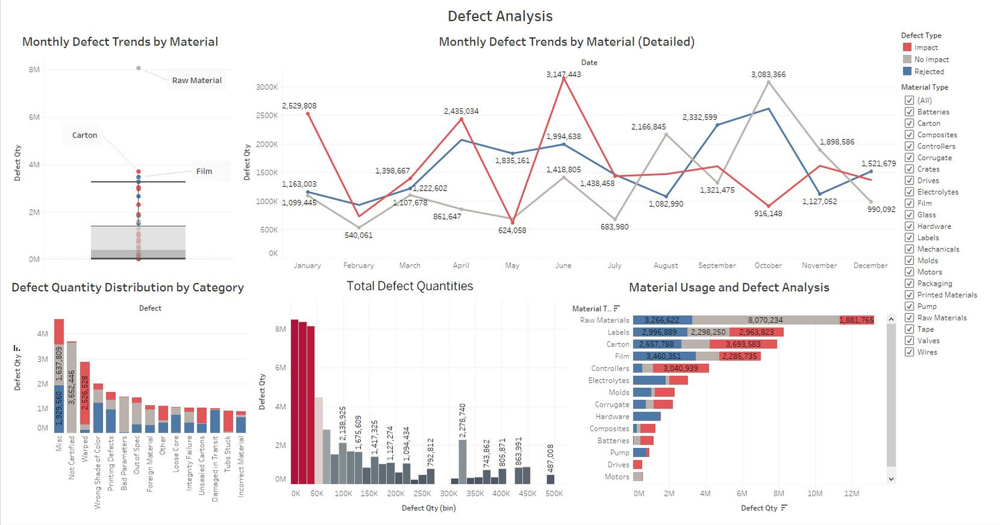
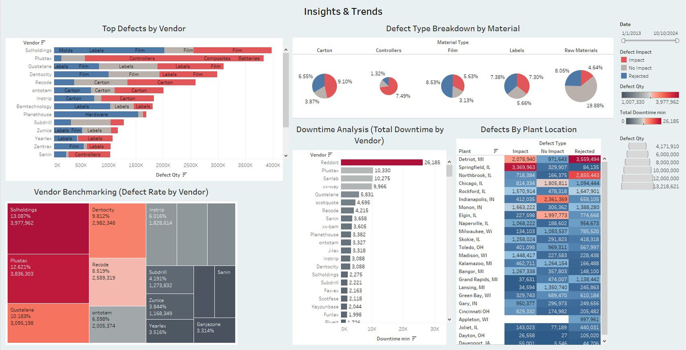

# Manufacturing Defects Analysis | Python & Tableau

 

**DEPI Data Analytics Capstone — Team Project**

## Project Overview

This collaborative project examines manufacturing defects, supplier performance, and production downtime across materials, vendors, and plant locations. The goal is to identify quality improvement opportunities and support operational decisions.

## My Contribution — Python & Data Preprocessing

I was responsible for the Python portion of the team project, including:

- Loading the defect dataset using pandas.
- Inspecting its shape, data types, and missing values.
- Identifying and removing 193 duplicate records.
- Handling missing values by dropping incomplete records.
- Exporting the cleaned data to CSV for further analysis and visualization.

The original Python cleaning workflow is documented in [this screenshot](Cleaning%20Using%20Python.JPG). The original executable notebook is not included.

## Dataset and Quality Checks

| Item | Value |
|---|---:|
| Initial records | 6,145 |
| Initial columns | 10 |
| Duplicate rows identified | 193 |
| Duplicate rows after removal | 0 |
| Tableau worksheets | 10 |
| Tableau dashboards | 2 |

The defect records include material, vendor, plant, defect quantity, and downtime fields. The original source workbook is not included in this repository.

## Dashboard Gallery — Team Deliverables

### 1. Defect Analysis

Monthly defect patterns, defect quantity distributions, and material comparisons.

### 2. Insights & Trends

Supplier comparisons, defect breakdowns, downtime by vendor, and plant-level analysis.

## Business Questions

- Which materials and vendors account for large defect quantities?
- How do defect quantities vary across months and defect categories?
- Which vendors are associated with the most recorded downtime?
- Which plants should be prioritized for further quality investigation?

## Analysis Highlights

The team report identifies raw materials as a major source of defect quantities, highlights supplier-level differences in recorded downtime, and identifies Detroit as a high-defect plant for further investigation. These descriptive results support targeted quality reviews rather than causal claims. Defect quantities and shares are not normalized defect rates without production-volume denominators.

## Project Files

- [Tableau workbook](Final%20Project.twb)
- [Final report (PDF)](Final%20Project%20%26%20Report%20AS%20PDF.pdf)
- [Presentation (PowerPoint)](Final%20Project%20%26%20Report%20AS%20POWERPOINT.pptx)
- [Python cleaning screenshot](Cleaning%20Using%20Python.JPG)

## Tools

Python · pandas · Tableau · Exploratory Data Analysis · Data Quality

## Limitations

The Tableau workbook references an external `final.xlsx` file that is not included, so the workbook may require a replacement data connection. Dashboard previews are provided for viewing the original team deliverables. The original raw data and executable Python notebook are not available in this repository.

## Team & Credits

- **Abdelrahman Omar:** Python and data preprocessing.
- **Hesham Amr:** Preparation of the final report and PowerPoint presentation.
- **DEPI project team:** Collaborative analysis and Tableau deliverables.

[Portfolio](https://abdelrahman-omar-portfolio.lovable.app) | [LinkedIn](https://www.linkedin.com/in/abdelrahman-omar-9370b8360/)
